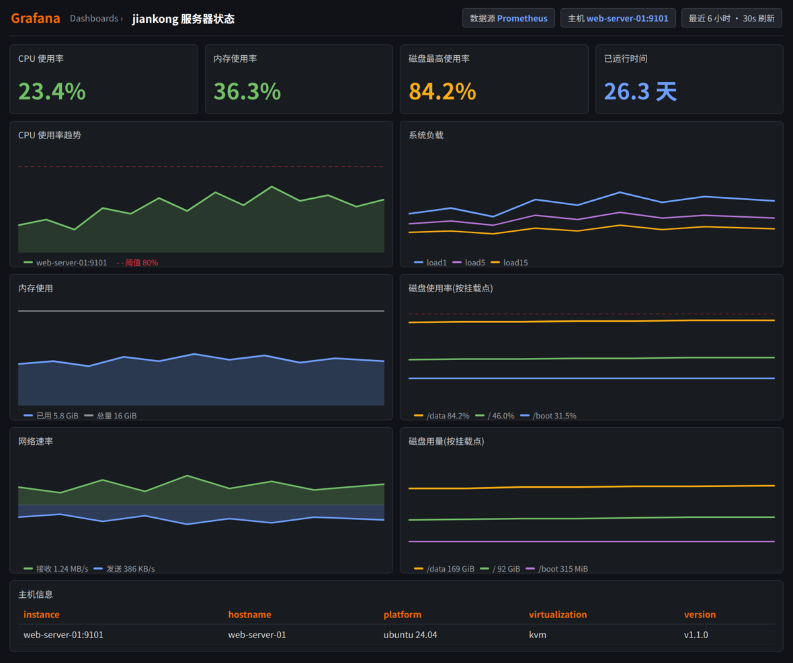

# jiankong-dingtalk

把一台 Linux 服务器的状态做成日报，通过钉钉机器人推送到群里。单文件 Go 程序、无常驻进程，配合 systemd 定时器每天定时发送一次。

推送内容：主机名、内网 IP、CPU / 内存 / 磁盘使用率（可设阈值，超限显示 ⚠️）、网络流量、系统版本与虚拟化类型、已运行时长。

## 配置（环境变量）

| 变量 | 必填 | 默认 | 说明 |
| --- | --- | --- | --- |
| `DING_WEBHOOK` | 是 | - | 钉钉机器人 Webhook 地址 |
| `DING_SECRET` | 否 | - | 机器人加签密钥（SEC 开头） |
| `CUSTOM_TITLE` | 否 | 服务器状态日报 | 推送标题 |
| `CPU_THRESHOLD` | 否 | 80 | CPU 使用率告警阈值（%） |
| `MEM_THRESHOLD` | 否 | 80 | 内存使用率告警阈值（%） |
| `DISK_THRESHOLD` | 否 | 80 | 磁盘使用率告警阈值（%） |
| `REPORT_TIME` | 否 | - | 计划推送时刻，仅在日报中展示，实际调度由 systemd 定时器决定 |

## 使用

### 进项目根目录
```
cd jiankong-dingtalk
```
### 拉依赖
```
go mod tidy
```
### 编译
```
CGO_ENABLED=0 go build -ldflags "-s -w" -o jiankong-dingtalk .
```
### 本地运行
```
export DING_WEBHOOK=https://oapi.dingtalk.com/robot/send?access_token=8dcbbd554a6yyyyyyyyyyyy51d5967exxxxxxxxxxxx7d38e27bea14
export DING_SECRET=SEC9fc1a5ef162dd30bexxxxxxxx759eda5a93d7xxxxxxxxxb4eb81d0bb5
./jiankong-dingtalk
```

### 压测方式
```
sudo apt-get install stress
# 4 核全部跑满 100 秒，Ctrl+C 随时停止
stress --cpu 4 --timeout 100s
# 申请 8 GB 内存 100 秒后自动释放
stress --vm 1 --vm-bytes 8G --timeout 100s
./jiankong-dingtalk
```
### systemd管理
#### 二进制放置
```
sudo cp jiankong-dingtalk /usr/local/bin/
sudo chmod +x /usr/local/bin/jiankong-dingtalk
```

#### systemd 单元文件
```
sudo tee /etc/systemd/system/jiankong-dingtalk.service >/dev/null <<'EOF'
[Unit]
Description=Push server status to DingTalk once
After=network-online.target
Wants=network-online.target

[Service]
Type=oneshot
# 关键环境变量
Environment=DING_WEBHOOK=https://oapi.dingtalk.com/robot/send?access_token=YOUR_TOKEN
Environment=DING_SECRET=YOUR_SECRET
Environment=CPU_THRESHOLD=85
Environment=MEM_THRESHOLD=85
Environment=DISK_THRESHOLD=85
Environment=REPORT_TIME=09:30
# 执行路径
ExecStart=/usr/local/bin/jiankong-dingtalk 
EOF
```
#### systemd 定时器
```
sudo tee /etc/systemd/system/jiankong-dingtalk.timer  >/dev/null <<'EOF'
[Unit]
Description=Daily jiankong to DingTalk

[Timer]
OnCalendar=*-*-* 09:30:00
Persistent=true

[Install]
WantedBy=timers.target
EOF
```

### 启用并立即测试
```
sudo systemctl daemon-reload
sudo systemctl enable --now jiankong-dingtalk.timer
# 手动验证
sudo systemctl start jiankong-dingtalk.service
journalctl -u jiankong-dingtalk --no-pager -e
```

## Prometheus 指标

除了推送日报，程序还带一个常驻的指标模式，把主机指标以 Prometheus 格式暴露出来，供 Prometheus 抓取、Grafana 展示。原来的推送模式不受影响。

```bash
# 直接运行（默认监听 :9101）
METRICS_ADDR=:9101 ./jiankong-dingtalk metrics

# 可选：给抓取加 token 鉴权（Prometheus 侧配同样的 token）
METRICS_ADDR=:9101 METRICS_TOKEN=你的token ./jiankong-dingtalk metrics
```

健康检查：`GET /healthz` 返回 `ok`。

用 systemd 常驻（与日报推送的 timer 并存，互不影响）：

```ini
# /etc/systemd/system/jiankong-dingtalk-metrics.service
[Unit]
Description=jiankong-dingtalk Prometheus metrics
After=network.target

[Service]
ExecStart=/opt/jiankong-dingtalk metrics
Environment=METRICS_ADDR=:9101
Restart=always
User=root

[Install]
WantedBy=multi-user.target
```

Prometheus 抓取配置（prometheus.yml）：

```yaml
scrape_configs:
  - job_name: jiankong
    static_configs:
      - targets: ['服务器IP:9101']
    # 设了 METRICS_TOKEN 时取消下面三行注释
    # authorization:
    #   type: Bearer
    #   credentials: 你的token
```

指标一览（每次抓取时实时采集）：

| 指标 | 说明 |
| --- | --- |
| `jiankong_cpu_usage_percent` | CPU 使用率(%) |
| `jiankong_memory_used_bytes` / `jiankong_memory_total_bytes` / `jiankong_memory_usage_percent` | 内存已用 / 总量 / 使用率 |
| `jiankong_swap_used_bytes` / `jiankong_swap_total_bytes` | 交换空间已用 / 总量 |
| `jiankong_disk_used_bytes` / `jiankong_disk_total_bytes` / `jiankong_disk_usage_percent` | 磁盘指标，带 `mountpoint` 标签按挂载点分开 |
| `jiankong_network_receive_bytes_total` / `jiankong_network_transmit_bytes_total` | 网络累计收 / 发字节，带 `device` 标签（计数器，用 `rate()` 算速率） |
| `jiankong_load1` / `jiankong_load5` / `jiankong_load15` | 系统负载 |
| `jiankong_uptime_seconds` / `jiankong_boot_time_seconds` | 已运行秒数 / 开机时间 |
| `jiankong_host_info` | 主机信息（`hostname` / `platform` / `virtualization` 标签） |
| `jiankong_build_info` | 版本信息（`version` 标签） |
| `jiankong_scrape_duration_seconds` | 本次采集耗时 |

## Grafana 看板

仓库里的 `grafana/dashboard.json` 是一份现成看板（三个 jiankong 项目（钉钉 / 飞书 / 企业微信），指标名完全一致，共用这一份）：

1. Grafana → Dashboards → New → Import
2. 上传 `grafana/dashboard.json`，选中你的 Prometheus 数据源
3. 顶部「主机」变量可按 instance 切换要看的机器

看板内容：顶部 Stat 卡（CPU / 内存 / 磁盘最高使用率、运行时长）、CPU 趋势、系统负载、内存使用、磁盘使用率与用量（按挂载点）、网络速率、主机信息表。



## 效果图


## 更新记录

## v1.2.0 (2026-11-15)

- 新增 Prometheus 指标模式：`jiankong-dingtalk metrics` 常驻暴露 `/metrics`（CPU / 内存 / 磁盘 / 网络 / 负载等指标），可选 token 鉴权
- 新增 Grafana 看板 `grafana/dashboard.json` 与看板预览图


### v1.1.0 (2026-11-13)
- 依赖升级：gopsutil v3 → v4.26、caarlos0/env v9 → v11，go.mod 提升到 Go 1.26
- 修复：钉钉返回 HTTP 200 但 errcode 非 0（被机器人拒绝）时旧版会误报推送成功，现在会正确报错
- 健壮性：推送请求增加 10 秒超时；内存/磁盘/网络指标采集失败时不再 panic，缺失项显示为 -
- 新增：单元测试（human / icon / signDing）、.gitignore
- 程序启动日志打印版本号（构建时用 `-ldflags "-X main.version=v1.1.0"` 注入）

### v1.0.0 (2025-07-16)
- 首个版本：服务器状态日报推送到钉钉（CPU / 内存 / 磁盘 / 网络 / 主机信息）
